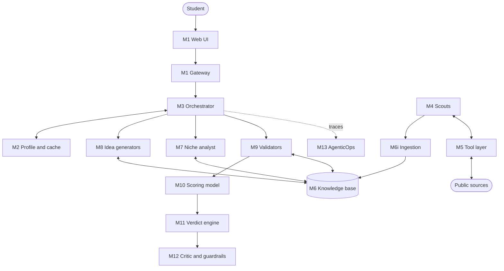

# Idea Generator with Go / No-Go

An interactive multi-agent system that helps a student choose a project. It collects startup ideas
and products from public sources, maps niches and trends, proposes ideas that fit a student's
profile, and returns a verdict (GO, PIVOT, NO-GO or INSUFFICIENT EVIDENCE) with its evidence.

CS4032 Software Construction and Development, semester project.
Members: [`Artfever`](https://github.com/Artfever) and
[`TahaSohail-Goat`](https://github.com/TahaSohail-Goat).

## Status

**Skeleton.** Every module has a container that answers `/health` and `/ready`, and the whole set
deploys to Kubernetes with its network rules. No product features exist yet. Progress is tracked in
the [issues](https://github.com/Artfever/SCD_Project/issues) and the [work plan](docs/plan.md).

## Architecture



Two rules shape the design: **no language model decides a verdict** (M11 is plain code), and
**only the tool layer reaches the internet** (enforced by NetworkPolicy).

| Module | Folder | Owner |
| --- | --- | --- |
| M1 Web UI and API gateway | `services/ui`, `services/gateway` | TahaSohail-Goat |
| M2 Profile, session and cache | `services/profile` | TahaSohail-Goat |
| M3 Orchestrator | `services/orchestrator` | TahaSohail-Goat |
| M4 Scout agents | `services/scouts` | Artfever |
| M5 Tool layer | `services/tools` | Artfever |
| M6 Knowledge base | `services/kb` | Artfever |
| M6i Ingestion | `jobs/ingestion` | Artfever |
| M7 Niche and trend analyst | `services/analyst` | Artfever |
| M8 Idea generators | `services/ideation` | TahaSohail-Goat |
| M9 Validators | `services/validators` | TahaSohail-Goat |
| M10 Scoring model | `services/scorer` | Artfever |
| M10t Fine-tuning | `jobs/finetune` | Artfever |
| M11 Verdict engine | `services/verdict` | TahaSohail-Goat |
| M12 Critic and guardrails | `services/critic` | TahaSohail-Goat |
| M13 AgenticOps | `services/agentops` | TahaSohail-Goat |
| M14 Platform | `.github`, `k8s`, `scripts`, `Jenkinsfile` | Artfever |

## Requirements

Git (with Git Bash on Windows), Python 3.12, Docker Desktop. For the cluster also `kubectl` and
`minikube`, and about 8 GB of free memory. Node 24 once the UI exists.

## Set up

```bash
git clone https://github.com/Artfever/SCD_Project.git
cd SCD_Project
git config core.hooksPath .githooks
python -m venv .venv                 # Python 3.12
source .venv/Scripts/activate        # Linux or macOS: source .venv/bin/activate
pip install -r requirements-dev.txt
bash scripts/check.sh                # lint, types, tests, repository rules
```

## Run with Docker Compose (development)

```bash
cp .env.example .env                 # then set POSTGRES_PASSWORD
docker compose --profile app up --build
```

UI on <http://127.0.0.1:8080>, gateway on <http://127.0.0.1:8000/health>, Postgres on host port
5433 (change `POSTGRES_PORT` in `.env`).
For Postgres and Redis only: `docker compose up -d postgres redis`.

## Run on Kubernetes

PowerShell (stops Compose services, then starts a 7 GB minikube node with Calico):

```powershell
.\scripts\lab.ps1 cluster
```

Git Bash:

```bash
bash scripts/build_images.sh local
bash scripts/load_images.sh local
bash scripts/deploy.sh local         # creates the database secret on first run
bash scripts/smoke_test.sh           # every service answers /ready
bash scripts/netpol_test.sh          # only the tool layer reaches the internet
```

To open the UI, run `minikube tunnel -p scd-project` and visit <http://127.0.0.1/>.
Stop with `.\scripts\lab.ps1 stop`. Read the [memory budget](docs/resource-budget.md) first.

Useful commands:

```bash
kubectl get pods -n idea-validator
kubectl top pods -n idea-validator
kubectl rollout undo deploy/gateway -n idea-validator
```

## CI/CD

GitHub Actions runs on every pull request. These checks are required on `main`:

| Check | What it does today |
| --- | --- |
| `lint-and-type` | ruff and strict mypy |
| `unit-tests` | pytest for each service |
| `ui-component-tests` | **Not active yet**: passes until `services/ui/package.json` exists (#12) |
| `retrieval-gate` | **Not active yet**: passes until `eval/retrieval/test_*.py` exists (#15) |
| `docker-build-scan` | Builds every image, fails on a fixable critical vulnerability |
| `manifest-validation` | kubeconform on the manifests, Compose file check |
| `repo-hygiene` | Conventional commits, no AI attribution, no course PDFs or env files, secret scan |

Jenkins delivers merged code and runs the nightly evaluation (`Jenkinsfile`). The Jenkins server is
not set up yet, so the pipeline has not been run (#5).

## Working together

`main` is protected: changes arrive by pull request, need the checks above and one approval from the
other member. See [CONTRIBUTING.md](CONTRIBUTING.md).

## Layout

```text
services/    one folder and Dockerfile per module
jobs/        ingestion, fine-tuning, evaluation
contracts/   shared JSON schemas
config/      verdict weights and thresholds (becomes a ConfigMap)
rubrics/     versioned scoring rubrics
eval/        retrieval and labelled evaluation sets
k8s/base/    Kubernetes manifests
platform/    Jenkins server setup
scripts/     checks, build, deploy and test scripts
docs/        plan, memory budget, decisions, AI-usage log, report material
```

## Documents

[Work plan](docs/plan.md) · [Memory budget](docs/resource-budget.md) ·
[Decisions](docs/decisions/) · [AI-usage log](docs/ai-usage-log.md) ·
[Contribution table](docs/contribution-table.md) · [Screenshot checklist](docs/screenshots/README.md)
